<div align="center">




<a href="#the-app"></a>
<a href="#screens"></a>
<a href="#eco-points-and-rules"></a>
<a href="#modules"></a>
<a href="#return-flow"></a>

<a href="#data-and-permissions"></a>
<a href="#run-it-locally"></a>
<a href="#limits"></a>
<a href="#project-layout"></a>



</div>

PHARVIA (Program Sirkular Obat) is a mobile-first web app for returning leftover and expired medicine. You scan or enter a pack, add it to a deposit, pick a drop-off point on a map, and collect Eco-Points that you can spend on rewards. The interface is in Indonesian.

The whole project is one static page, `index.html`, plus a few images in `assets/`. There is no backend, no database and no build step. Everything you add (deposits, the chosen drop-off point, redemptions, the profile) is kept in your browser with `localStorage`.

## The app


The home screen gathers the main actions: scan a medicine, find a drop-off point, open Eco-Points, and read short education articles. The bottom navigation switches between the home, deposit, drop-off point, Eco-Points, activity and profile views.

Three education cards ship with the page. Their artwork is in `assets/` and plays below as an archive slideshow (the titles here are translated to English; the app shows them in Indonesian).

<div align="center">


</div>

## Screens


<div align="center">


</div>

These are real screenshots of `index.html` rendered at phone size with the built-in sample data. They are not mockups, but they do show sample names, points and history, not live data.

## Eco-Points and rules


The bench below replays the formulas used in the page's script. Every returned item adds 20 points to the balance. The balance starts at 130 points in the sample data. The level is read from the balance: Eco Starter below 400, Eco Guardian from 400, Eco Champion from 1000.

<div align="center">


</div>

| Quantity | Formula in the page | Example for 14 items |
| --- | --- | --- |
| Points | 20 per item | 280 |
| Estimated weight | 0.1 kg per item | 1.4 kg |
| Estimated CO2e | 0.07 kg per item | 0.98 kg |
| Starting balance | 130 points | 410 in total |

<details>
<summary>How the level thresholds work</summary>

<br>

The page compares the total balance with two limits. At 1000 points or more the level is Eco Champion. At 400 points or more it is Eco Guardian. Below that it is Eco Starter. The progress bar under the level shows how far the balance is from the next limit.

</details>

<details>
<summary>What the reward catalog offers</summary>

<br>

Four sample rewards are listed, with their costs in points: plant one mangrove seedling (150), a pharmacy voucher of Rp25,000 (200), 20% off Eco-Bath (120) and community water sanitation (300). Redeeming one deducts its cost and writes an entry to the history. The catalog and the history are seed data inside the page. No voucher is actually issued.

</details>

## Modules


<div align="center">


</div>

<details>
<summary>Scan medicine: three input modes</summary>

<br>

The scan screen has three tabs: barcode, package photo and manual entry. The camera is requested with the rear camera preferred. The page checks for the `BarcodeDetector` API and falls back to a message when the browser does not support it. Recognized data fills the form with name, strength, form, ingredient, maker, expiry, quantity, count, batch and condition. Adding an item to the deposit shows +20 points per item.

</details>

<details>
<summary>Find a point: four sample locations</summary>

<br>

The map uses Leaflet 1.9.4 with OpenStreetMap tiles. Four sample points sit around Gandaria and Kebayoran in South Jakarta: Apotek Sehat Farma, Apotek Kimia Farma Gandaria, Drop-Box Pharvia Gandaria City and Apotek Mitra Kebayoran. Each shows hours, the medicine types it accepts and a free-space bar. You can filter by partner, 24 hours and distance. The addresses and hours are sample data, so confirm them before you rely on them.

</details>

<details>
<summary>Eco-Points: balance, history and rewards</summary>

<br>

The balance, the history of earned and spent points and the reward catalog share one screen. Redemptions are stored in `localStorage` under `pharvia.ecoPoints.redemptions`.

</details>

## Return flow


<div align="center">



</div>

The scene is an illustration, not a map of a real facility. In the app a deposit shows as Diproses (in process) until it is finished, and Selesai (done) after that. The statuses and the verification messages are demo data in the page. Nothing is checked by a server.

## Data and permissions


<div align="center">


</div>

<details>
<summary>What is stored in your browser</summary>

<br>

Four `localStorage` keys are used: `pharvia.scanDeposits` for the deposit list, `pharvia.selectedDropoff` for the chosen point, `pharvia.ecoPoints.redemptions` for redeemed rewards and `pharvia.profile` for the profile (name, photo and the expiry reminder switch). Clearing site data in your browser removes all of it. Nothing is sent to a server by the page's own code.

</details>

<details>
<summary>Which requests leave the browser</summary>

<br>

The page loads Tailwind CSS from `cdn.tailwindcss.com`, Leaflet from `unpkg.com`, and Plus Jakarta Sans and Material Symbols from Google Fonts. Map tiles come from `tile.openstreetmap.org`. The directions button opens Google Maps in a new tab. You need an internet connection for the page to look right.

</details>

<details>
<summary>Camera and location</summary>

<br>

The camera is only requested on the scan screen and the location only when you ask for the nearest point. Browsers allow both only on `localhost` or HTTPS, which is why the run command below serves the page from `localhost`.

</details>

There are no user accounts and no roles in this project. Everyone who opens the page has the same view.

## Run it locally


<div align="center">


</div>

```bash
git clone <your-fork-or-copy-of-the-repository> pharvia
cd pharvia
python3 -m http.server 8000
# then open http://localhost:8000/ in your browser
```

Any static file server works. You can also open `index.html` directly, but the camera and location features need `localhost` or HTTPS, so a local server is the better choice. There is no package to install and the project ships no tests or Docker files.

## Limits


- All data is stored per browser. A deposit made on one device does not appear on another.
- Drop-off points, rewards, the history and the activity totals are sample data inside the page. The sample "kg neutralized" figures on the activity screen are fixed text.
- The app does not contact a pharmacy, issue vouchers or verify a deposit. The statuses are labels.
- Barcode and package photo recognition fill in sample data (a Panadol-style product). There is no medicine database behind them.
- The weight and CO2e values are simple per-item estimates (0.1 kg and 0.07 kg), not measurements.
- `BarcodeDetector` is not available in every browser. Manual entry always works.
- The page needs the CDN files listed above. Offline, the layout and the map will not load.

## Project layout


```text
.
├── index.html                 the whole app: markup, styles and script
├── assets/
│   ├── pharvia-logo.png
│   ├── pharvia-logo-transparent.png
│   ├── profile-photo.jpg      sample profile picture
│   ├── article-environment.svg
│   ├── article-safety.svg
│   └── article-storage.svg
└── docs/
    └── readme/                the animated SVGs used by this README
```

<div align="center">


</div>
